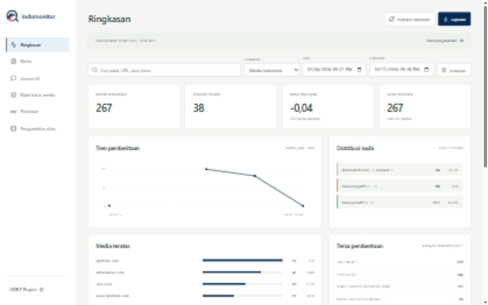

<p align="center"></p>

# Indomonitor

**Media Intelligence & Sentiment Analysis untuk pemberitaan Indonesia.** Ambil metadata berita dari GDELT, telusuri sumbernya, pantau perubahan volume dan nada pemberitaan V2Tone, lalu tanyakan konteks isu melalui asisten AI berkutip.

Indomonitor memakai data yang benar-benar dikumpulkan. Database kosong menampilkan keadaan kosong; sumber gagal menghasilkan status gagal. Tidak ada berita contoh yang mengisi aplikasi atau jawaban AI palsu sebagai pengganti layanan yang gagal.

Repositori mandiri: [github.com/ramaikn/indomonitor](https://github.com/ramaikn/indomonitor). Lisensi: [Apache 2.0](LICENSE). Dokumentasi dan antarmuka utama menggunakan Bahasa Indonesia. Tidak memerlukan repositori portofolio atau Semantree untuk berjalan.

## Tampilan aplikasi



Screenshot aplikasi lokal dengan data GDELT yang tersimpan. Waktu data terakhir ada di dashboard; status kegagalan dan riwayat collector tersedia di tab Pengambilan data. Analisis nada memakai V2Tone, bukan model sentimen yang dilatih sendiri.

## Fitur

- Filter periode, kata kunci, domain media, dan cakupan Indonesia.
- Daftar berita berhalaman, detail tema/lokasi/nada, serta riwayat sumber.
- Volume per jam, media dominan, tema otomatis GDELT, dan distribusi nada.
- Kemiripan judul lintas domain dengan aturan yang dapat diperiksa.
- Pantauan kata kunci persisten dengan ambang volume 24 jam.
- Laporan Markdown berdasarkan filter aktif.
- Asisten AI kompatibel OpenAI, termasuk gateway 9router, dengan kutipan statistik dan berita.
- Pencarian web opsional melalui adapter 9router `/v1/search` untuk menambah konteks.
- Collector arsip 15 menit: validasi, deduplikasi URL, quarantine, checkpoint transaksi, retry terbatas, dan pengisian gap setelah berhenti.

## Batas analisis

Jumlah berita berarti **URL unik tersimpan dalam filter**, bukan seluruh pemberitaan Indonesia. Waktu berasal dari observasi GDELT, bukan tanggal terbit asli. Nada V2Tone merupakan skor otomatis pemberitaan, bukan opini masyarakat atau penilaian terhadap tokoh.

Kategori tema dapat tumpang tindih. Sampel judul dan kemiripan judul tidak membuktikan ranking kasus nasional, koordinasi, manipulasi, hoaks, atau aktivitas buzzer. Asisten dapat menjelaskan kasus yang ditemukan tetapi tidak mengarang rincian artikel penuh. Kutipan AI diperiksa identitasnya, bukan dibuktikan otomatis kebenaran setiap kalimatnya.

## Arsitektur

```text
GDELT GKG / DOC API
        │
        ▼
Pipeline Python ──► PostgreSQL ◄── Backend Java / Spring Boot
                                           │
                                 React / TypeScript
                                           │
                                Asisten AI dan pencarian
                                  melalui backend saja
```

| Folder | Tanggung jawab |
| --- | --- |
| `pipeline/` | Pengambilan, normalisasi, penyimpanan, jadwal collector |
| `database/` | Migrasi Flyway yang digunakan bersama backend dan pipeline |
| `backend/` | API, query SQL, laporan, kemiripan judul, asisten AI |
| `frontend/` | Dashboard, penelusuran bukti, pantauan, percakapan |
| `scripts/` | Penyiapan dan pengujian Windows portabel |
| `docs/` | Arsitektur, hak sumber, keamanan, dan hasil verifikasi |

Tidak memerlukan Kafka, Redis, GPU, atau database vektor. PostgreSQL menjadi sumber angka yang ditampilkan.

## Prasyarat

- **Bun** untuk frontend dan **uv** untuk Python.
- Java 21, Maven 3.9+, PostgreSQL 17 untuk backend dan penyimpanan.
- Koneksi internet untuk GDELT serta penyedia AI/pencarian jika digunakan.
- Windows PowerShell 5.1 atau lebih baru untuk script yang disediakan.

Script Windows dapat memasang Java, Maven, dan PostgreSQL secara portabel ke `.tools/` tanpa mengubah PATH sistem atau membuat layanan Windows. Pilihan `INDOMONITOR_TOOLS_DIR` dapat menunjuk instalasi portabel bersama dengan struktur `jdk/`, `maven/`, dan `pgsql/`.

## Mulai di Windows

```powershell
git clone https://github.com/ramaikn/indomonitor.git
cd indomonitor
powershell -NoProfile -ExecutionPolicy Bypass -File scripts/setup.ps1
```

`-ExecutionPolicy Bypass` hanya berlaku untuk proses script tersebut. `start-database.ps1` membuat `.env` lokal dengan password dan kunci admin acak. **Jangan menyalin `.env.example` menjadi `.env` sebelum penyiapan otomatis**, karena nilai contoh bukan kredensial database yang siap digunakan.

Setup memasang dependensi Bun/uv dengan hardlink dan memulai database. Saat menjalankan ulang aplikasi, cukup jalankan `scripts/start-database.ps1` terlebih dahulu, tidak perlu mengulang setup. JDK diverifikasi SHA-256 dan Maven SHA-512; arsip PostgreSQL diunduh melalui HTTPS vendor tanpa checksum independen di script.

Terminal backend:

```powershell
powershell -NoProfile -ExecutionPolicy Bypass -File scripts/start-backend.ps1
```

Migrasi database berjalan otomatis. Backend dijalankan dari `.runtime/application.jar` agar Windows tidak mengunci hasil build Maven.

Terminal collector:

```powershell
cd pipeline
uv sync --link-mode hardlink
uv run media-ingest archive --batches 16
# Pengambilan berkala, bukan otomatis dimulai oleh dashboard:
uv run media-ingest archive --batches 4 --watch 15
```

Terminal frontend:

```powershell
powershell -NoProfile -ExecutionPolicy Bypass -File scripts/start-frontend.ps1
```

Buka **http://127.0.0.1:5173**. API berada di `127.0.0.1:8080`; database portabel pada `127.0.0.1:55432`. Semuanya bind ke loopback. Hardlink memerlukan cache dan proyek pada filesystem yang sama; jika tidak, alat dapat menggunakan copy.

Tombol **Perbarui tampilan** hanya membaca ulang database. Jalankan collector untuk mengambil data baru. Browser tidak memulai scraping.

### Berpindah dari proyek portofolio

Gunakan checkout repo ini sebagai lokasi kerja, bukan arsip `project/media-intelligence` di repo lamaran. Lokasi lokal terbaru adalah `project/indomonitor` dalam folder kerja lamaran; checkout mempunyai Git sendiri dan diabaikan oleh repo induk. Backend, frontend, pipeline, database migrations, dan docs berada dalam satu monorepo. Branding Indomonitor berada di `frontend/public/indomonitor-*.svg`; nama lama Ruang Media adalah identitas versi arsip.

Untuk mempertahankan data, hentikan backend/frontend dan PostgreSQL lama, buat backup database, lalu pindahkan `.runtime/pgdata` dan salin `.env` ke root checkout Indomonitor. Jangan membuat `.env` baru dengan password berbeda untuk cluster lama. Schema dan nama database tetap `media_intelligence`, sehingga migrasi branding tidak menghapus artikel, checkpoint, atau pantauan. Jangan menyalin runtime ke Git.

Tools lama dapat digunakan kembali dengan `INDOMONITOR_TOOLS_DIR` di `.env`; nilai lokal ini tidak ikut repositori. Jalankan database, backend, dan frontend dari checkout baru. Periksa `/api/health` serta jumlah artikel sebelum melanjutkan collector. Port yang digunakan proses lain harus ditinjau, bukan dianggap sebagai bukti aplikasi yang benar sudah berjalan.

### Berhenti

Hentikan frontend, backend, dan collector dengan `Ctrl+C`, lalu:

```powershell
powershell -NoProfile -ExecutionPolicy Bypass -File scripts/stop-database.ps1
```

### Linux/macOS atau instalasi manual

Backend, frontend, dan pipeline tidak bergantung pada Windows; script penyiapan saat ini khusus Windows. Siapkan PostgreSQL beserta role pemilik migrasi dan role API. `database/V1__initial.sql` dan `V2__watchlist_permissions.sql` menunjukkan tabel serta izin yang dibutuhkan. Role API hanya membaca artikel dan mengubah watchlist.

Ekspor variabel dari [.env.example](.env.example) ke environment proses menggunakan kredensial database Anda, lalu jalankan:

```sh
# Backend, dari backend/
mvn package
java -jar target/media-intelligence-0.1.0.jar
# Collector, dari pipeline/
uv sync --link-mode hardlink
uv run media-ingest archive --batches 16
# Frontend, dari frontend/
bun install --backend hardlink --frozen-lockfile
bun run dev
```

CLI pipeline membaca `.env` di root proyek. Java tidak membaca file itu secara otomatis di luar script Windows. Jangan menjalankan backend memakai role superuser database.

## Konfigurasi

| Variabel | Fungsi |
| --- | --- |
| `DATABASE_URL` | Koneksi PostgreSQL untuk collector |
| `JDBC_DATABASE_URL` | Koneksi JDBC backend dan migrasi |
| `DB_USER`, `DB_PASSWORD` | Role API dengan hak terbatas |
| `MIGRATION_USER`, `MIGRATION_PASSWORD` | Role pemilik schema untuk Flyway |
| `LOCAL_PG_PASSWORD` | Superuser untuk penyiapan lokal saja |
| `ADMIN_API_KEY` | Minimal 32 karakter, diperlukan untuk perubahan pantauan |
| `API_PORT` | Port backend, default `8080` |
| `AI_BASE_URL`, `AI_API_KEY`, `AI_MODEL` | Endpoint kompatibel OpenAI, kunci, dan ID model |
| `SEARCH_BASE_URL`, `SEARCH_API_KEY`, `SEARCH_MODEL` | Endpoint pencarian kompatibel 9router dan penyedianya |
| `FRONTEND_ORIGIN` | Origin frontend yang boleh memanggil asisten; default `http://127.0.0.1:5173` |
| `INDOMONITOR_TOOLS_DIR` | Lokasi alternatif alat portabel Windows |

Kunci admin dan AI tidak ditanam di source code. Kunci admin tidak disimpan browser. Simpan `.env` lokal dengan akses file yang sesuai.

## Asisten AI

Tambahkan ke `.env` yang telah dibuat, lalu jalankan ulang backend:

```dotenv
AI_BASE_URL=http://127.0.0.1:20128/v1
AI_API_KEY=isi_kunci_gateway_anda
AI_MODEL=isi_id_model_yang_tersedia
SEARCH_BASE_URL=http://127.0.0.1:20128/v1
SEARCH_API_KEY=
SEARCH_MODEL=
FRONTEND_ORIGIN=http://127.0.0.1:5173
```

Contoh pertanyaan:

- “Tema apa yang paling banyak diberitakan dalam periode ini?”
- “Bagaimana perubahan volume dibanding periode sebelumnya?”
- “Media mana yang paling banyak memberitakan?”
- “Jelaskan berita tentang Rafale yang tersedia.”

Asisten mengikuti filter aktif. Mengubah filter memulai percakapan baru; perpindahan tab tidak menghapusnya. Riwayat disimpan dalam memori browser saja. Backend membuat rencana kata kunci, membaca snapshot database, dan meminta penjelasan. Kode tidak menerima SQL atau tindakan eksekusi dari model.

Gateway lokal **tidak berarti offline**: pertanyaan, riwayat, statistik, dan metadata bukti dapat diteruskan ke penyedia model. Jangan mengirim rahasia. Penggunaan dapat memerlukan biaya dan mengikuti ketentuan penyedia.

### Mengaktifkan pencarian web

Konfigurasi penyedia pencarian di 9router, lalu periksa `GET /v1/models/web`. Isi `SEARCH_MODEL` dengan ID pencarian yang benar dan `SEARCH_API_KEY` jika gateway memerlukan autentikasi. Kunci pencarian terpisah dan tidak otomatis disalin dari kunci AI. Model chat biasa tidak otomatis memiliki browsing.

Adapter mengirim `POST /v1/search` dengan `model`, `query`, dan `max_results`. Ia membaca `results` berisi `title`, `url`, `snippet`, dan opsional `published_at`. Endpoint lain dapat digunakan jika mengikuti kontrak ini. Maksimal enam hasil dipakai sebagai konteks; aplikasi tidak mengambil isi penuh URL berita.

Hasil web tidak mengubah database/dashboard dan tidak menjadi ukuran volume nasional. Tanpa konfigurasi, pilihan web tidak aktif. Jika pencarian gagal, status terlihat dan analisis database tetap dapat diberikan. Kebenaran dan kebaruan cuplikan perlu diperiksa melalui sumber asli.

## Pengambilan data

Collector default mengambil edisi **original dan translation** GKG. Original dominan Inggris; translation membantu cakupan media Indonesia. Setiap arsip mewakili batch 15 menit.

- Pengambilan pertama memulai dari batch terbaru sebanyak `--batches` per edisi.
- Putaran berikutnya mendahulukan gap tertua sejak batch pertama yang pernah dicoba, dengan batas kerja per putaran.
- Arsip sukses tidak diulang. Batch `partial` perlu peninjauan quarantine dan tidak diperlakukan sebagai checkpoint sukses.
- Tidak otomatis mengambil seluruh arsip sebelum batch pertama.

```powershell
# Replay eksplisit; timestamp dalam UTC:
uv run media-ingest archive --at 20261008110000 --edition original --batches 1 --reprocess
# Metadata DOC opsional; dapat terkena 429:
uv run media-ingest doc --query "transportation" --hours 24
```

Collector menghormati pembatasan penyedia, tidak mengubah IP atau melewati paywall. Lihat [sumber dan hak penggunaan](docs/data-sources.md).

## API

| Endpoint | Fungsi |
| --- | --- |
| `GET /api/health` | Database, pengambilan terakhir, keberhasilan terakhir |
| `GET /api/articles` | Daftar berhalaman sesuai filter |
| `GET /api/articles/{id}` | Detail dan riwayat sumber |
| `GET /api/analytics` | Statistik, timeline, tema, sumber, nada |
| `GET /api/evidence` | Pasangan judul serupa |
| `GET /api/runs` | Maksimal 40 pengambilan terbaru |
| `GET /api/report` | Laporan Markdown |
| `GET /api/watchlists`, `GET /api/alerts` | Pantauan dan evaluasi ambang |
| `POST /api/watchlists`, `DELETE /api/watchlists/{id}` | Perubahan dengan `X-Admin-Key` |
| `GET /api/assistant/status` | Kesiapan AI/web tanpa secret |
| `POST /api/assistant` | Pertanyaan dan bukti; wajib JSON dan Origin yang diizinkan |

Filter: `from`/`to` ISO UTC, awal inklusif dan akhir eksklusif; `q`, `domain`, `scope`. Default cakupan `indonesian_outlet`; alternatif `mentions_indonesia` dan `all`. Maksimal rentang 366 hari dan ukuran halaman 100. Detail kontrak berada di [peta sistem](docs/architecture.md).

## Pengujian

Windows, setelah database lokal tersedia:

```powershell
powershell -NoProfile -ExecutionPolicy Bypass -File scripts/test.ps1
```

Script mengisi ulang **database test terpisah** `media_intelligence_test`, menjalankan pytest/Ruff, pengujian Java, dan build frontend. Jangan arahkan `TEST_DATABASE_URL` ke database aplikasi: pengujian transaksi menghapus fixture sebelumnya.

Tanpa database, unit test parser dan klien bisa dijalankan dengan `uv run pytest -q`; pengujian penyimpanan akan skipped. Backend: `mvn test`. Frontend: `bun run build`. Hasil yang benar-benar diperiksa dicatat di [verifikasi](docs/verification.md), bukan klaim cakupan penuh.

## Pemecahan masalah

| Gejala | Pemeriksaan |
| --- | --- |
| Dashboard kosong | Periksa periode/cakupan, jalankan collector, lihat riwayat pengambilan |
| Data lama | Refresh tidak mengambil berita; collector harus berjalan |
| DOC mengembalikan 429 | Tunggu sesuai pembatasan; jangan melakukan bypass |
| AI belum tersedia | Isi kunci/model yang valid dan restart backend |
| Web tidak aktif | Konfigurasi penyedia dan ID pada `/v1/models/web` |
| POST asisten 403 | Origin harus sesuai `FRONTEND_ORIGIN` atau Origin backend yang sama |
| Perubahan pantauan 401 | Gunakan kunci admin lokal yang benar |
| Port sudah digunakan | Hentikan layanan lain atau sesuaikan port/backend proxy; jangan mulai database kedua di port yang sama |

## Keamanan dan deployment

**Source code publik tidak berarti layanan siap dibuka ke publik.** Saat ini aplikasi ditujukan untuk penggunaan lokal dan belum memiliki login multi-tenant, TLS, audit akses, atau rate limiting per pengguna. Sebelum hosting, tambahkan autentikasi, batas biaya AI, pengelolaan secret, backup/retensi, dan kebijakan pengiriman data. Jangan membuka port atau membuat tunnel tanpa review. Baca [SECURITY.md](SECURITY.md) dan [batas keamanan](docs/security.md).

## Kontribusi dan lisensi

Lihat [CONTRIBUTING.md](CONTRIBUTING.md). Kode tersedia dengan **[Apache License 2.0](LICENSE)**. Dependensi tetap mengikuti lisensinya masing-masing. Data GDELT memerlukan atribusi; hak isi artikel tetap pada penerbit dan tidak diberikan oleh lisensi kode ini.

Logo SVG dibuat ulang dari referensi branding yang diberikan pemilik proyek, dengan latar transparan. Nama dan logo mengidentifikasi proyek; lisensi kode tidak memberi hak merek atau menyiratkan dukungan terhadap produk turunan.
